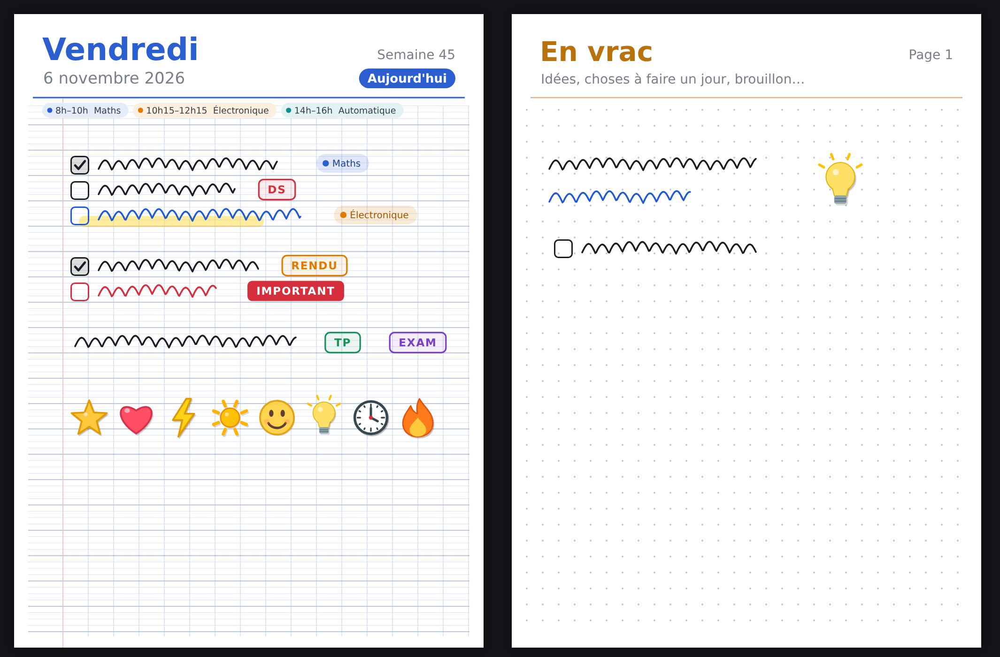
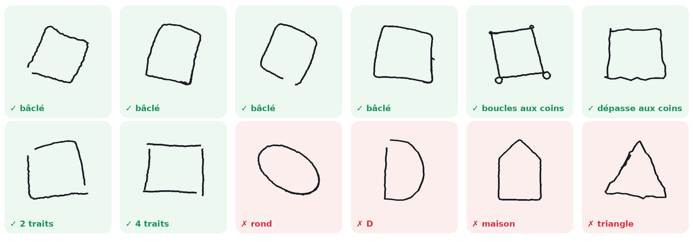
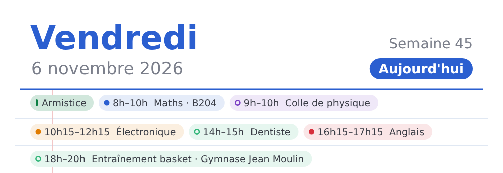
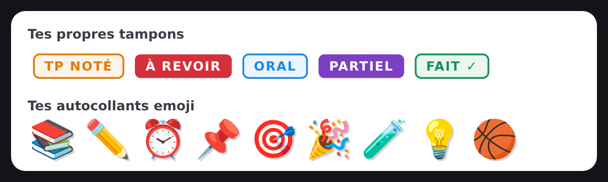
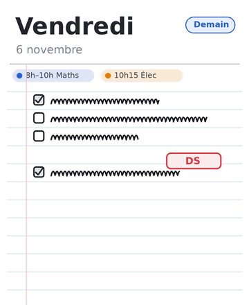

# Agenda manuscrit

**Français** · [English](README.md)

**Un agenda pour tablette Android qu'on remplit au stylet, comme un vrai carnet.** Une page par jour, deux pages côte à côte en paysage, des cases à cocher dessinées à la main, l'emploi du temps et Google Agenda en haut de chaque page, un widget pour le lendemain. Sans compte, sans pub, sans connexion internet.



* * *

## Sommaire

-   [Fonctionnalités](#fonctionnalit%C3%A9s)
-   [Installer](#installer)
-   [Compiler](#compiler)
-   [Tests](#tests)
-   [Comment c'est fait](#comment-cest-fait)
-   [Confidentialité](#confidentialit%C3%A9)
-   [Contribuer](#contribuer)

* * *

## Fonctionnalités

### Écrire

-   **Encre au stylet** avec pression, 4 couleurs (réglables : appui long sur une couleur), 3 épaisseurs, surligneur, gomme.
-   **Écriture au doigt** en option ; la paume posée sur l'écran est ignorée.
-   **Lasso** : entourer pour déplacer, agrandir, recolorer, copier/coller, supprimer.
-   **Annuler / rétablir**, y compris d'une page à l'autre.
-   **Zoom** à deux doigts, **page qui s'allonge** quand on écrit en bas.
-   **Bouton du stylet** réglable : gomme, surligneur, lasso, annuler ou rien.

### Organiser

-   **Un jour par page** (deux en paysage), ouverture toujours sur aujourd'hui, **page qui tourne** (désactivable).
-   **Vue Semaine** avec miniatures, **calendrier** avec un point sur les jours où il y a quelque chose d'écrit.
-   **« En vrac »** : un carnet à part, sans dates, pour les idées et le brouillon.
-   **Reporter** une sélection au lendemain, à une date ou dans « En vrac ».
-   **Fonds de page** : ligné, Seyès, petits carreaux, pointillés, blanc.
-   **Statistiques** : série de jours où tout est coché, record, graphique du mois.

### Cases à cocher

Un carré dessiné devient une case, toujours à la même taille. Il peut être penché, en trapèze, mal fermé, avec une petite boucle aux coins, ou fait en 2 à 4 traits. Un appui coche la case, une coche dessinée dedans aussi.



### Emploi du temps et Google Agenda

-   **Emploi du temps** de la semaine (matière, heures, salle), affiché en pastilles en haut de chaque jour.
-   **Google Agenda** (optionnel) : les événements de l'agenda synchronisé sur la tablette s'ajoutent aux pastilles, en lecture seule. Un événement dont le titre contient une matière en prend la couleur ; un doublon d'un cours n'est pas affiché deux fois.
-   Tout est affiché en entier : quand une ligne est pleine, les pastilles passent à la ligne.



### Tampons, matières, autocollants

-   **Tampons** (DS, TP, EXAM, IMPORTANT…) : crée les tiens (texte, couleur, contour ou plein), modifie-les, supprime-les.
-   **Matières** en couleur : pastilles posées sur les pages, points dans les calendriers, couleurs de l'emploi du temps.
-   **Autocollants** : 8 dessins inclus, et autant d'emoji que tu veux.



### Widget

Un widget d'écran d'accueil montre **la page de demain** (pour voir ce qu'il reste à préparer). Il remplit tout son cadre, en portrait comme en paysage. Un appui ouvre l'agenda sur demain.



* * *

## Installer

1.  Télécharge `Agenda.apk` depuis la page **Releases**, ou compile-le (voir plus bas).
2.  Ouvre-le sur la tablette et autorise l'installation d'applis inconnues pour l'application qui l'ouvre. Ou, depuis un ordinateur : `adb install -r Agenda.apk`.

Configuration requise : Android 5.0 ou plus récent. L'appli est pensée pour une tablette avec stylet, mais elle marche au doigt (menu ⋮ → *Écrire aussi au doigt*).

Pour Google Agenda : le compte Google doit être ajouté dans les paramètres d'Android avec la synchronisation « Agenda » activée, puis dans l'appli : menu ⋮ → *Emploi du temps & Google Agenda* → interrupteur.

> Une mise à jour ne s'installe par-dessus l'ancienne version que si elle est signée avec la **même clé**. Désinstaller l'appli efface les notes.

* * *

## Compiler

Le projet n'utilise ni Android Studio ni Gradle : un simple script enchaîne les outils du SDK.

```bash
# Debian / Ubuntu
sudo apt install openjdk-21-jdk-headless android-sdk-platform-23 aapt dalvik-exchange zipalign apksigner

./build.sh          # produit Agenda.apk
```

Étapes de `build.sh` : `aapt` (ressources → `R.java`) → `javac` (Java 8) → `dx` (bytecode Dalvik, `classes.dex`) → `aapt` (archive) → `zipalign` → `apksigner`.

**Signature.** Sans configuration, une clé de développement est créée dans `debug.jks`. Pour signer avec ta propre clé, crée un fichier `keystore.properties` à la racine (il est ignoré par git) :

```properties
KEYSTORE=ma-cle.jks
KEYSTORE_PASS=mot-de-passe
KEY_ALIAS=agenda
```

ou passe les mêmes variables dans l'environnement. `ANDROID_JAR=…` permet de pointer vers un autre `android.jar`. Ne publie jamais ta clé (`*.jks`) : n'importe qui pourrait signer des « mises à jour » à ta place.

* * *

## Tests

Les parties sans interface (modèle, fichiers, annulation, séries, Google Agenda, réglages, reconnaissance des carrés) se testent sur la JVM, avec des bouchons pour les quelques classes d'Android utilisées :

```bash
tests/run.sh          # quelques secondes
tests/run.sh 4000     # mesure fine de la reconnaissance des carrés (~1 min)
```

La reconnaissance des carrés est mesurée sur des tracés simulés (`tests/src/.../Gen.java`) : carrés plus ou moins bâclés, en 1 à 4 traits, et formes qui ne doivent pas devenir des cases (ronds, ellipses, D, P, maisons, étoiles, lettres en plusieurs traits…). Résultats typiques : 99 % des carrés « un peu de travers », ~92 % des très bâclés, ~98 % des carrés en plusieurs traits, aucun faux positif sur plus de 10 000 formes.

* * *

## Comment c'est fait

Java « à l'ancienne » (pas de lambdas : l'outil `dx` ne les accepte pas), API Android directes, sans bibliothèque externe. Environ 10 000 lignes dans `src/fr/agenda/manuscrit/` :

| Fichier | Rôle |
| --- | --- |
| `MainActivity` | barres d'outils, onglets Jour / Semaine / En vrac, menu, panneau Insérer, sélection |
| `BookPager` | 1 ou 2 pages, glisser / pincer / défiler, animation de page qui tourne |
| `InkPageView` | encre, gomme, lasso, cases, placement d'objets, zoom, bouton du stylet |
| `PageRenderer` | papier, fonds, pastilles, traits, cases, tampons, matières, autocollants |
| `Item` / `Stroke` / `Obj` | éléments immuables posés sur une page |
| `Edit` / `Page` / `PageStore` | annuler / rétablir, lecture et écriture des fichiers, résumés par jour |
| `Shapes` | reconnaissance des carrés (1 à 4 traits), lasso, hauteur de page |
| `Settings` | réglages : fonds, stylet, matières, tampons, emoji, couleurs, emploi du temps, Google Agenda |
| `CalendarSource` / `CalEvents` | lecture de l'agenda d'Android, fusion avec l'emploi du temps |
| `WeekView` / `WeekStripView` / `CalendarDialog` | vue semaine, bande des jours, calendrier |
| `ScheduleDialog` / `SubjectsDialog` / `StampsDialog` / `StatsDialog` / `Kit` | fenêtres de réglage et éléments d'interface |
| `TodayWidget` | widget d'écran d'accueil (page de demain) |

**Données** (stockage interne de l'appli) :

-   `files/pages/AAAA-MM-JJ.ink` : un fichier par jour ; `files/vrac/0001.ink` : pages « En vrac ».
-   Format binaire v2 : en-tête (nombre de cases, cases cochées, matières du jour), puis traits (points x, y, pression) et objets. Écriture dans un fichier temporaire puis renommage, pour ne jamais laisser de page à moitié écrite.
-   Réglages : `SharedPreferences` nommées `agenda`.
-   Les événements Google ne sont jamais copiés : ils sont relus depuis l'agenda d'Android.

**Reconnaissance des carrés** (`Shapes.recognizeBox`) : le tracé est refermé (amorce et dépassement coupés), ré-échantillonné, puis on repère ses 4 virages les plus francs. Chaque côté est remplacé par une droite ajustée, les coins sont leurs intersections. Le carré est accepté si le quadrilatère obtenu est convexe, aux angles pas trop loin de 90°, si le tracé le suit de près et le remplit, si les coins sont nets et les côtés pas des arcs. Les seuils ont été réglés sur environ 230 000 tracés simulés.

Outils : `tools/icons.py` (icônes), `tools/widget_preview.py` (aperçu du widget).

* * *

## Confidentialité

-   **Aucune autorisation internet** : l'appli ne peut rien envoyer nulle part.
-   Seule autorisation demandée : **lire l'agenda** (`READ_CALENDAR`), et seulement si tu actives Google Agenda. Lecture seule.
-   Tout reste dans le stockage interne de l'appli, sur ta tablette.

* * *

## Contribuer

Les propositions sont bienvenues (tickets, pull requests). Quelques règles du projet :

-   syntaxe **Java 8 sans lambdas ni références de méthode** (contrainte de `dx`) ;
-   compatible **Android 5.0 (API 21)** : pas d'API plus récente sans vérification de version ;
-   interface en français ;
-   `./build.sh` et `tests/run.sh` doivent passer.
-   projet réalisé à l’aide de Claude opus 5.5

L'historique des versions est dans [CHANGELOG.md](CHANGELOG.md).