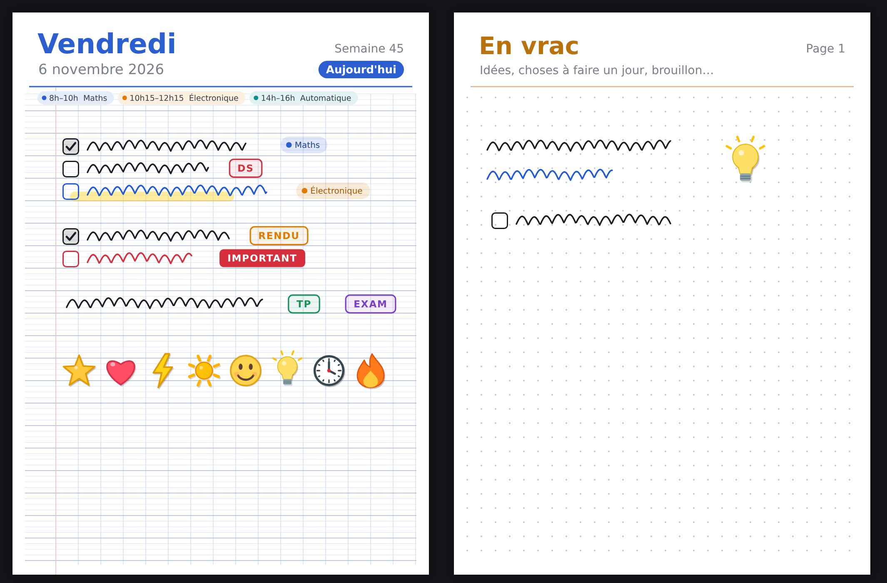
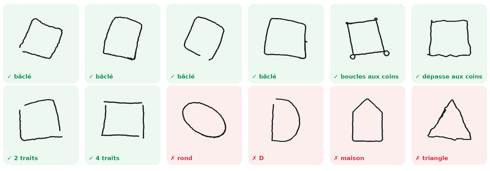
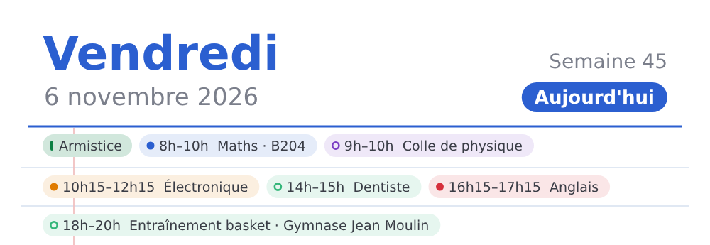
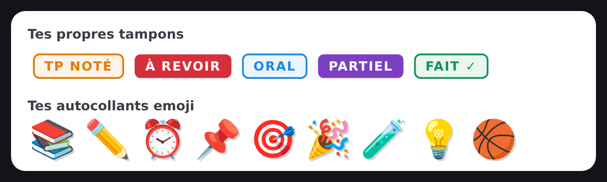
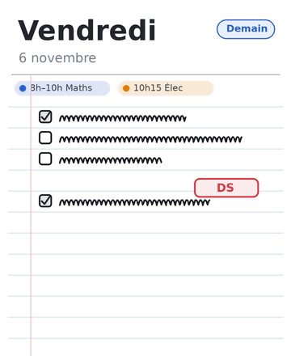

# Agenda manuscrit

[Français](README.fr.md) · **English**

**A handwritten planner for Android tablets, filled in with a stylus like a real paper notebook.** One page per day, two pages side by side in landscape, check boxes drawn by hand, your timetable and Google Calendar at the top of each page, and a widget showing tomorrow. No account, no ads, no internet connection.

> The app's interface is in French.



* * *

## Contents

-   [Features](#features)
-   [Install](#install)
-   [Build](#build)
-   [Tests](#tests)
-   [How it works](#how-it-works)
-   [Privacy](#privacy)
-   [Contributing](#contributing)

* * *

## Features

### Writing

-   **Stylus ink** with pressure, 4 colours (customisable: long-press a colour), 3 widths, highlighter, eraser.
-   **Finger writing** as an option; a palm resting on the screen is ignored.
-   **Lasso**: circle things to move, resize, recolour, copy/paste or delete them.
-   **Undo / redo**, even across pages.
-   Two-finger **zoom**; the **page grows** when you write near the bottom.
-   Configurable **stylus button**: eraser, highlighter, lasso, undo or nothing.

### Organising

-   **One day per page** (two in landscape), always opens on today, **page-turn animation** (can be turned off).
-   **Week view** with thumbnails; a **calendar** with a dot under the days where something is written.
-   **"En vrac"**: a separate, undated notebook for ideas and rough notes.
-   **Move** a selection to tomorrow, to any date, or to "En vrac".
-   **Page backgrounds**: lined, Seyès (French ruled), small squares, dots, blank.
-   **Statistics**: streak of days with everything checked, record, monthly chart.

### Check boxes

A square you draw becomes a check box, always at the same size. It can be tilted, trapezoid-shaped, not quite closed, have small loops at the corners, or be drawn in 2 to 4 strokes. Tap it to check it, or draw a tick inside.



### Timetable and Google Calendar

-   Weekly **timetable** (subject, times, room), shown as pills at the top of each day.
-   **Google Calendar** (optional): events from the calendar synced on the tablet are added to the pills, read-only. An event whose title contains a subject takes that subject's colour; an event that duplicates a class is shown only once.
-   Everything is shown in full: when a row is full, pills wrap to the next line.



### Stamps, subjects, stickers

-   **Stamps** (DS, TP, EXAM, IMPORTANT…): create your own (text, colour, outline or filled), edit or delete them.
-   Colour-coded **subjects**: pills placed on pages, dots in the calendars, timetable colours.
-   **Stickers**: 8 built-in drawings, plus as many emoji as you like.



### Widget

A home-screen widget shows **tomorrow's page** (so you see what's left to prepare). It fills its whole frame, in portrait and landscape. Tapping it opens the planner on tomorrow.



* * *

## Install

1.  Download `Agenda.apk` from the **Releases** page, or build it yourself (see below).
2.  Open it on the tablet and allow installing unknown apps for the app that opens it. Or, from a computer: `adb install -r Agenda.apk`.

Requirements: Android 5.0 or newer. The app is designed for a tablet with a stylus, but it works with a finger (menu ⋮ → *Écrire aussi au doigt*).

For Google Calendar: the Google account must be added in Android's settings with "Calendar" sync turned on; then, in the app: menu ⋮ → *Emploi du temps & Google Agenda* → switch.

> An update only installs over the previous version if it is signed with the **same key**. Uninstalling the app deletes your notes.

* * *

## Build

The project uses neither Android Studio nor Gradle: a plain script chains the SDK tools.

```bash
# Debian / Ubuntu
sudo apt install openjdk-21-jdk-headless android-sdk-platform-23 aapt dalvik-exchange zipalign apksigner

./build.sh          # produces Agenda.apk
```

`build.sh` steps: `aapt` (resources → `R.java`) → `javac` (Java 8) → `dx` (Dalvik bytecode, `classes.dex`) → `aapt` (archive) → `zipalign` → `apksigner`.

**Signing.** With no configuration, a development key is created in `debug.jks`. To sign with your own key, create a `keystore.properties` file at the root (git ignores it):

```properties
KEYSTORE=my-key.jks
KEYSTORE_PASS=password
KEY_ALIAS=agenda
```

or pass the same variables in the environment. `ANDROID_JAR=…` points to a different `android.jar`. Never publish your key (`*.jks`): anyone could sign "updates" in your name.

* * *

## Tests

The parts without UI (model, files, undo, streaks, Google Calendar, settings, square recognition) are tested on the JVM, with stubs for the few Android classes they use:

```bash
tests/run.sh          # a few seconds
tests/run.sh 4000     # fine-grained square-recognition benchmark (~1 min)
```

Square recognition is measured on simulated strokes (`tests/src/.../Gen.java`): squares drawn more or less carelessly, in 1 to 4 strokes, and shapes that must not become check boxes (circles, ellipses, D, P, houses, stars, multi-stroke letters…). Typical results: 99 % of slightly crooked squares, ~92 % of very sloppy ones, ~98 % of multi-stroke squares, and no false positives over more than 10,000 shapes.

* * *

## How it works

"Old-school" Java (no lambdas: the `dx` tool rejects them), direct Android APIs, no external library. About 10,000 lines in `src/fr/agenda/manuscrit/`:

| File | Role |
| --- | --- |
| `MainActivity` | toolbars, Day / Week / En vrac tabs, menu, Insert panel, selection |
| `BookPager` | 1 or 2 pages, swipe / pinch / scroll, page-turn animation |
| `InkPageView` | ink, eraser, lasso, check boxes, placing objects, zoom, stylus button |
| `PageRenderer` | paper, backgrounds, pills, strokes, check boxes, stamps, subjects, stickers |
| `Item` / `Stroke` / `Obj` | immutable items placed on a page |
| `Edit` / `Page` / `PageStore` | undo / redo, reading and writing files, per-day summaries |
| `Shapes` | square recognition (1 to 4 strokes), lasso, page height |
| `Settings` | settings: backgrounds, stylus, subjects, stamps, emoji, colours, timetable, Google Calendar |
| `CalendarSource` / `CalEvents` | reading Android's calendar, merging with the timetable |
| `WeekView` / `WeekStripView` / `CalendarDialog` | week view, day strip, calendar |
| `ScheduleDialog` / `SubjectsDialog` / `StampsDialog` / `StatsDialog` / `Kit` | settings windows and UI building blocks |
| `TodayWidget` | home-screen widget (tomorrow's page) |

**Data** (app-private storage):

-   `files/pages/YYYY-MM-DD.ink`: one file per day; `files/vrac/0001.ink`: "En vrac" pages.
-   Binary format v2: header (number of boxes, checked boxes, subjects of the day), then strokes (x, y, pressure points) and objects. Written to a temporary file then renamed, so a page is never left half-written.
-   Settings: `SharedPreferences` named `agenda`.
-   Google events are never copied: they are read again from Android's calendar.

**Square recognition** (`Shapes.recognizeBox`): the stroke is closed (lead-in and overshoot trimmed), resampled, and its 4 sharpest turns are found. Each side is replaced by a fitted straight line; the corners are their intersections. The square is accepted if the resulting quadrilateral is convex with angles not too far from 90°, if the stroke follows it closely and fills it, and if the corners are crisp and the sides are not arcs. Thresholds were tuned on about 230,000 simulated strokes.

Tools: `tools/icons.py` (icons), `tools/widget_preview.py` (widget preview).

* * *

## Privacy

-   **No internet permission**: the app cannot send anything anywhere.
-   The only permission requested is **reading the calendar** (`READ_CALENDAR`), and only if you turn on Google Calendar. Read-only.
-   Everything stays in the app's private storage, on your tablet.

* * *

## Contributing

Suggestions are welcome (issues, pull requests). A few project rules:

-   **Java 8 syntax without lambdas or method references** (a `dx` constraint);
-   compatible with **Android 5.0 (API 21)**: no newer API without a version check;
-   the interface is in French;
-   `./build.sh` and `tests/run.sh` must pass.
-   Project created with the help of Claude opus 5.5

The version history is in [CHANGELOG.md](CHANGELOG.md) (in French).